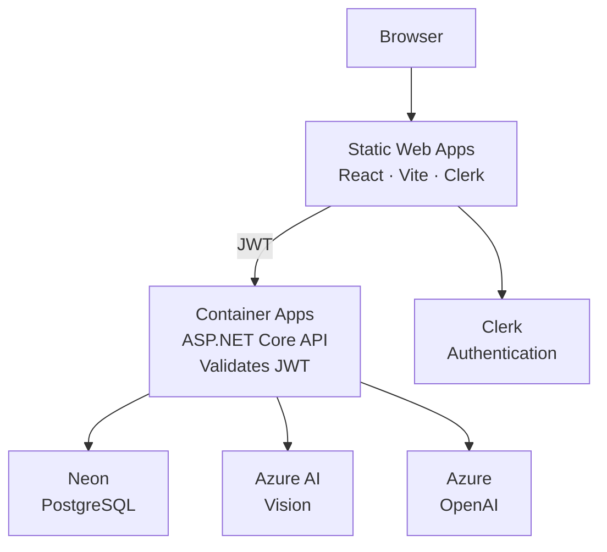
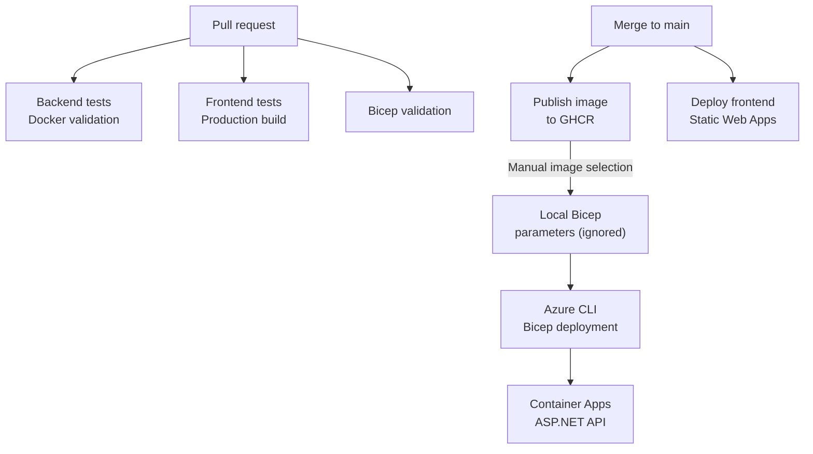

# Note2QuizAI

Note2QuizAI turns uploaded study notes into quizzes using Azure AI Vision and Azure OpenAI.

It runs a containerized ASP.NET Core API on Azure Container Apps with a React frontend on Azure Static Web Apps, PostgreSQL, Bicep IaC, and GitHub Actions.

## Live deployment

- Frontend: https://white-flower-05e98d103.5.azurestaticapps.net
- API health: https://note2quiz-api.agreeablemeadow-fe18a8ae.westeurope.azurecontainerapps.io/health

## Architecture



## Technology

- Backend: .NET 10, ASP.NET Core, EF Core, Npgsql, PostgreSQL
- Frontend: React, TypeScript, Vite, Clerk
- AI: Azure AI Vision, Azure OpenAI
- Infrastructure and delivery: Docker, Docker Compose, Bicep (IaC), GitHub Actions, GHCR, Azure Container Apps, Azure Static Web Apps

## Delivery flow



Publishing to GHCR does not automatically redeploy Container Apps. See [infra/README.md](infra/README.md) for deployment and verification details.

## Local development

Start the API and local PostgreSQL with Docker Desktop running:

```bash
docker compose up --build
```

The API is available at `http://localhost:8080` and its health endpoint at `http://localhost:8080/health`. Configure Azure Vision and Azure OpenAI credentials outside Git for quiz generation.

For the frontend, create `note2quiz-ui/.env.local` from `note2quiz-ui/.env.example` and configure the intended Clerk publishable key and API URL:

```bash
cd note2quiz-ui
npm ci
npm run dev
```

Run the backend and frontend checks from the repository root:

```powershell
dotnet test note2quiz-backend/Note2Quiz.slnx
cd note2quiz-ui
npm ci
npm test
npm run build
```
